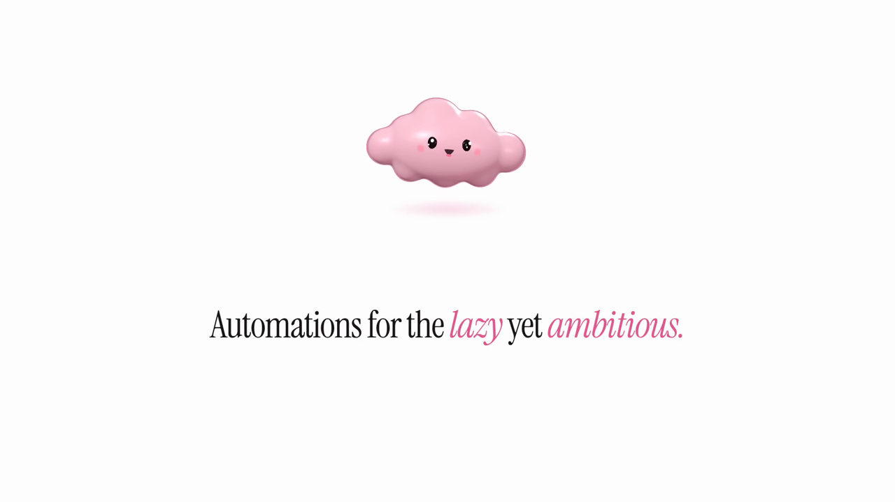
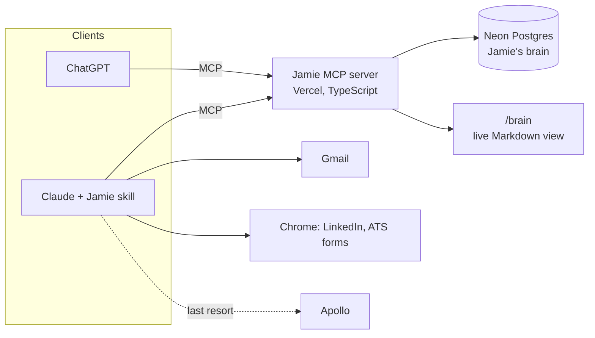

# Jamie: an AI agent that learns as it goes

Jamie doesn't just apply to jobs. He's built to grow like a person: every day his brain holds more, and every task makes him a little smarter.

Jamie has a brain that remembers everything he has done before. Each fact I give him, each answer I approve, and each lesson from a task gets saved. The next day he starts from all of it. He does real work, keeps a memory of the past, and goes wherever I work.

His first job is my job search. He applies to roles, finds the right people, and writes outreach in my voice. Under the hood he is a remote **MCP server** with a shared brain, so Claude and ChatGPT both connect to the same Jamie. Work started in one picks up cleanly in the other. A **Claude skill** tells him how to do the work. Every action that matters waits for my yes.

[](docs/jamie-demo.mp4)

▶️ **[Watch the 53-second walkthrough](docs/jamie-demo.mp4)**

## What Jamie does

| | |
|---|---|
| **Applies to jobs** | Works through my LinkedIn saved jobs. Skips duplicates, picks the right resume, fills factual fields, waits for my OK on custom answers. |
| **Finds the right people** | Researches the hiring manager or recruiter on the public web, finds the company email format, checks the domain's MX records. |
| **Writes in my voice** | Drafts outreach in Gmail from my own template, matches the ask to the contact's role, shows me the exact text. |
| **Watches for bounces** | Checks Gmail at 1 hour and 24 hours. A clean 24 hours confirms the email pattern. Apollo is used only as a last resort. |
| **Learns as it goes** | Saves facts I give or correct, approved answers for reuse, ATS quirks, email patterns and contacts. |
| **Works across Claude and ChatGPT** | Shared memory plus a handoff note at the end of every session. |
| **Weekly summary** | Sends, bounces, Apollo credits, applications, and what Jamie learned. |

## Where Jamie is going

The goal is for Jamie to feel less like a job search tool and more like a person.

- **More context:** his brain keeps growing with every task
- **More places:** beyond chat apps, into my everyday tools
- **A voice:** talk to him and hear him answer
- **More skills:** new kinds of tasks over time

**Today:** Jamie runs in Claude and ChatGPT and handles my job search. Voice and the rest are next.

## Rules the agent can't bend

Enforced in the skill **and** in the server, not left to judgment.

- Nothing is submitted without my yes
- Every email is approved before it sends
- Every custom answer is approved, then logged for review
- No passwords, sign-ins, or CAPTCHAs
- Never re-applies to the same role
- Honest framing, no inflated titles
- Skips roles needing more than 3 years
- Hard caps: 45 mass apps and 250 emails a day
- 3 bounces at a company stops guessing there
- One Apollo lookup per bounced person, then dead end


## Architecture



- **Transparent memory.** Jamie's whole brain renders as one Markdown file (`jamie_get_brain` or `/<secret>/brain`). If it's not in that file, Jamie doesn't know it.
- **Facts are versioned.** Corrections retire the old fact and link to the new one, so nothing is silently overwritten.
- **Guardrails live in the database.** `jamie_can_send` and `jamie_log_application` refuse actions past the caps, even if the model forgets.

## Tools (26)

| Area | Tools |
|---|---|
| Session | `jamie_start_session`, `jamie_write_handoff`, `jamie_get_brain` |
| Knowledge | `jamie_get_profile`, `jamie_add_fact`, `jamie_add_lesson`, `jamie_search_lessons` |
| Answers | `jamie_search_answers`, `jamie_save_answer`, `jamie_log_submitted_answers`, `jamie_review_submitted_answers` |
| Applications | `jamie_check_applied`, `jamie_log_application`, `jamie_can_apply`, `jamie_list_applications` |
| Contacts and email | `jamie_upsert_contact`, `jamie_check_domain`, `jamie_guess_email`, `jamie_save_email_pattern` |
| Sending and bounces | `jamie_can_send`, `jamie_log_send`, `jamie_mark_bounce_checked`, `jamie_record_bounce`, `jamie_log_apollo` |
| Settings and reporting | `jamie_update_settings`, `jamie_weekly_summary` |

## Project structure

```
api/mcp.ts          Vercel function entry point
src/http.ts         Secret check, routes /mcp, /brain, /seed
src/server.ts       All MCP tools and guardrail logic
src/db.ts           Postgres pool, auto-migration, settings helpers
src/schema.ts       Tables and default guardrail settings
src/brain.ts        Renders the brain as Markdown
src/seed.ts         One-time seed loader
src/seedData.ts     Demo seed data (fictional)
skill/SKILL.md      The Claude skill: Jamie's rules and workflows
docs/               Walkthrough video and images
```

## Run your own

1. Create a free Postgres database (I use [Neon](https://neon.tech)).
2. Deploy to Vercel and set two environment variables (see `.env.example`):
   - `DATABASE_URL`: your Postgres connection string
   - `JAMIE_SECRET`: a random string, at least 24 characters
3. Replace `src/seedData.ts` with your own facts, then open `https://<your-app>/<JAMIE_SECRET>/seed` once.
4. Add `https://<your-app>/<JAMIE_SECRET>/mcp` as a custom connector in Claude and ChatGPT.
5. Add `skill/SKILL.md` as a Claude skill.

Tables are created automatically on first request.

## Privacy

This repo contains **no personal data and no keys**. The seed data is fictional. My real knowledge base lives only in a private database, and all secrets are environment variables.

## Stack

TypeScript · Model Context Protocol SDK · Zod · Postgres (Neon) · Vercel · Claude · ChatGPT · Gmail · Apollo

---

Built by [Vishwa Mehta](https://vishwamehta.vercel.app/) · [LinkedIn](https://www.linkedin.com/in/vishwa10)
